# Audio Plotter

A real-time audio waveform plotter implemented on **STM32H750B-DK** discovery board. It captures audio from either the on-board **MEMS PDM microphones and SAI module** or an external **analog microphone paired with ADC**, and draws the waveform live on the 480×272 pixel LCD in an oscilloscope-style sweep.
## Demo:

|              MEMS microphone               |                ADC input                 | Recorded sine wave frequency |
| :----------------------------------------: | :--------------------------------------: | ---------------------------- |
| 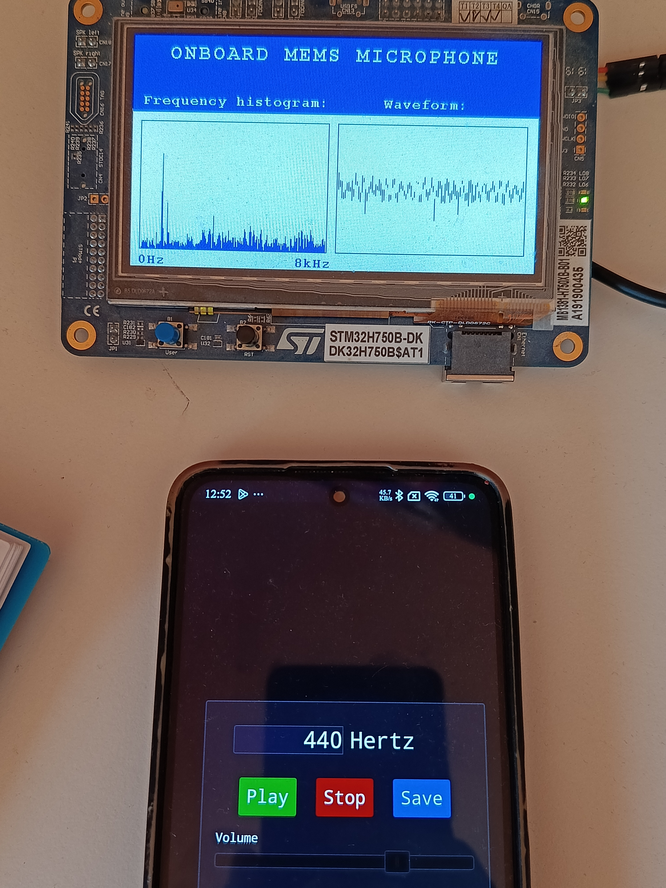 | 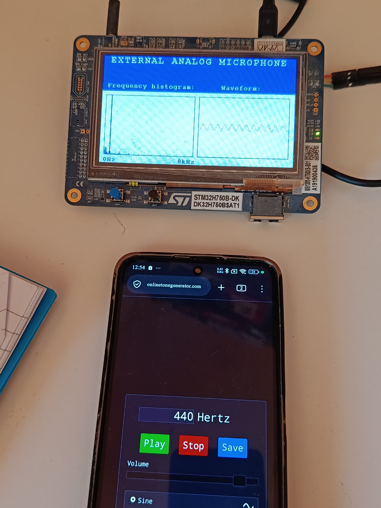 | 440 Hz                       |
|  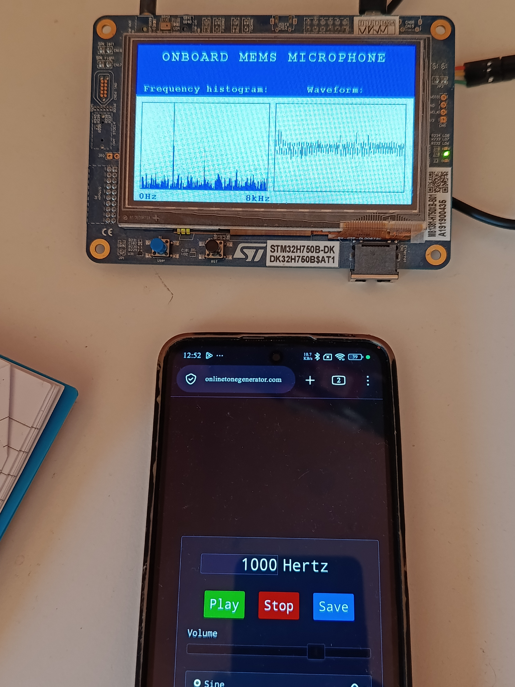  | 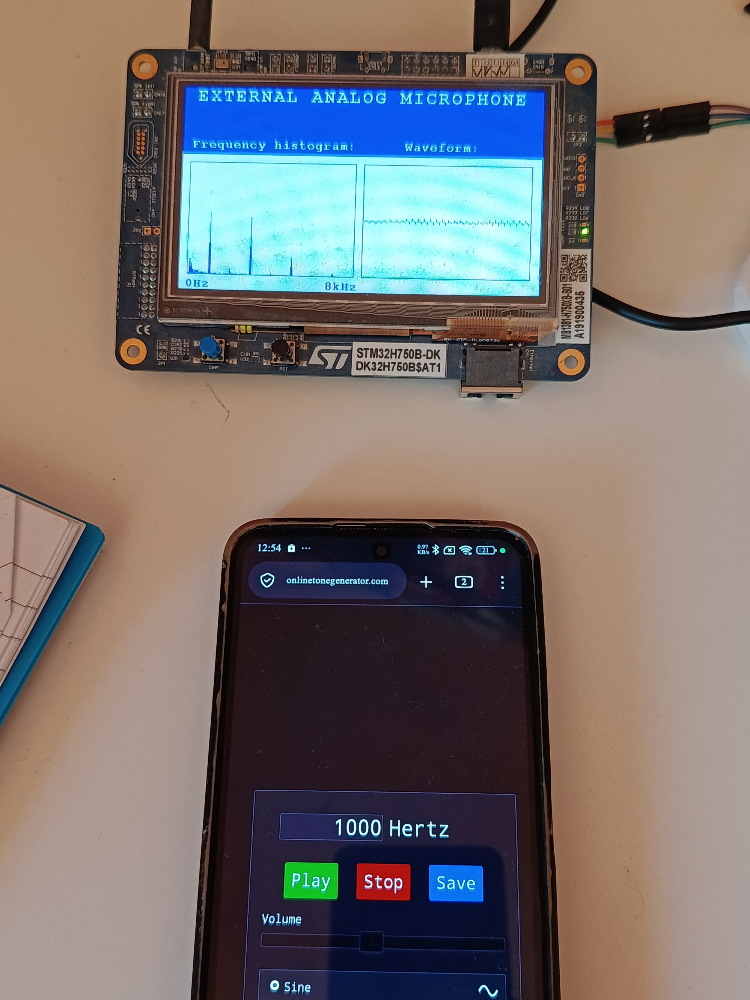  | 1 kHz                        |
| 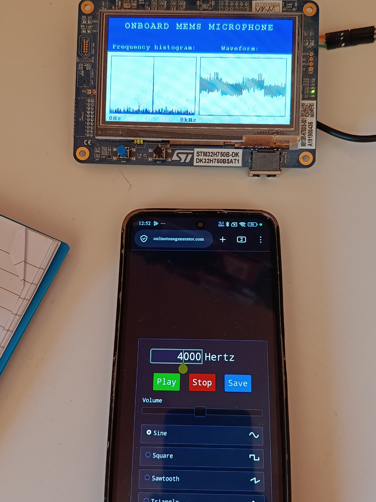  | 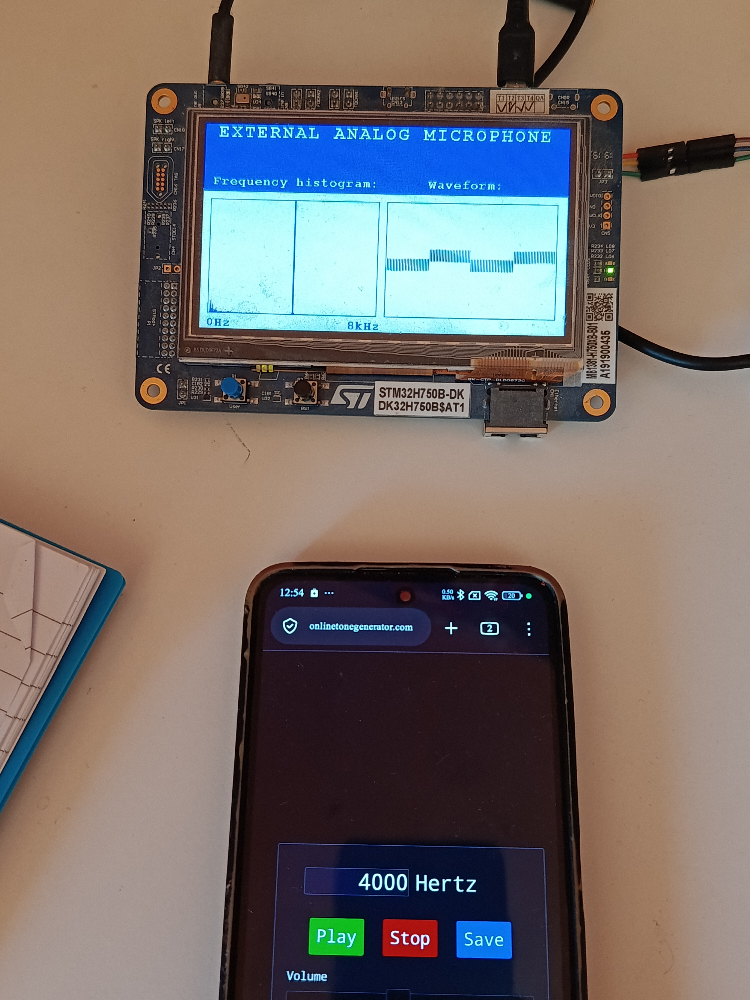  | 4 Khz                        |
|  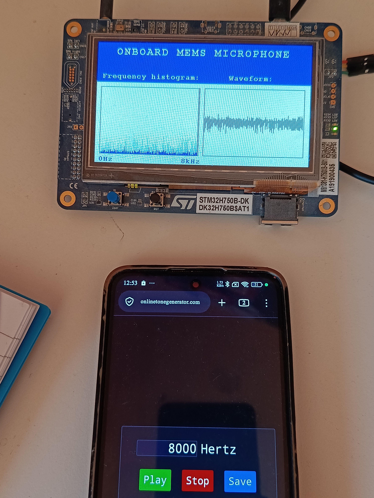  | 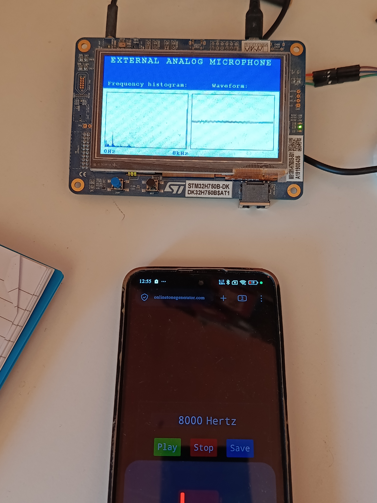  | 8 kHz                        |

## Hardware:

- STM32H750B-DK (Cortex-M7, 480×272 RGB LCD, on-board PDM MEMS mics)
- For the ADC demo: an analog signal on **PF8** (ADC3 channel 7)
- Toolchain: STM32CubeIDE, STM32 HAL + board BSP

## Pipeline
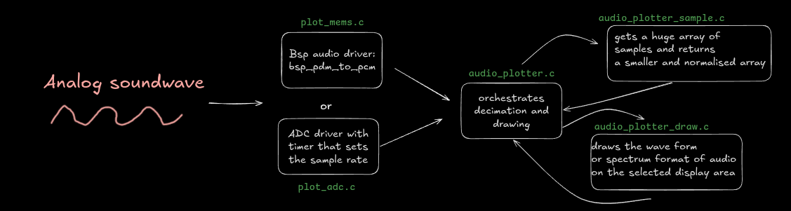
```
 capture (DMA)  ──►  segment queue  ──►  decimate  ──►  draw  ──►  display
```

1. **Capture.** DMA fills a circular buffer and fires half-transfer / transfer-complete callbacks, so one half is processed while the other is being filled.
2. **Segment queue.** Each callback hands the main loop a chunk of samples as an `audio_segment_t` (pointer + length) via a small ring-buffer queue (`audio_queue.c`). This decouples the interrupt context from the drawing code.
3. **Decimation** (`audio_plotter_sample.c`). A chunk of samples is reduced to one value per pixel column of the plot segment. Three methods are available:
   - `SAMPLE_DECIMATION`: pick every Nth sample (fastest)
   - `PEAK_DECIMATION`: min/max per group (preserves transients)
   - `AVG_DECIMATION`: average per group (smoothest)

   The DC offset is subtracted here so the waveform is centred on zero.
4. **Draw** (`audio_plotter_draw.c`). The plot window is split into `n_segments` slots. Each new chunk is drawn into the next slot, then the slot index wraps, giving a sweeping display. For each update:
   - the previous frame is copied front → back buffer with **DMA2D** (memory-to-memory),
   - the segment area is cleared with **DMA2D** (register-to-memory),
   - the waveform is drawn with **Bresenham lines written directly into the SDRAM back buffer**,
   - the D-cache is cleaned so the LTDC sees the pixels,
   - the buffers are swapped by reloading the LTDC layer address **during vertical blanking** to avoid tearing.
5. **Double buffering.** Two framebuffers (`BUFFER_PING`, `BUFFER_PONG`) live in SDRAM. The SDRAM region is configured as non-cacheable via the MPU.

## Connecting ADC microphone to the board:
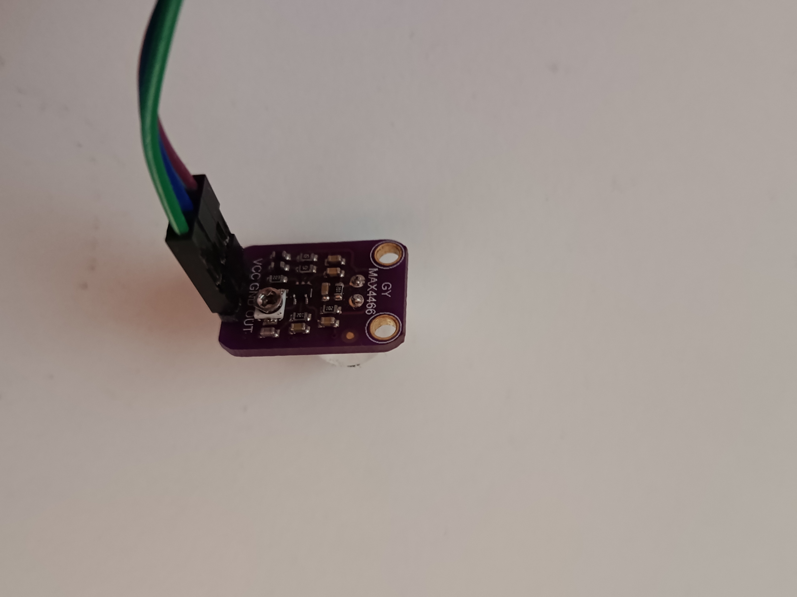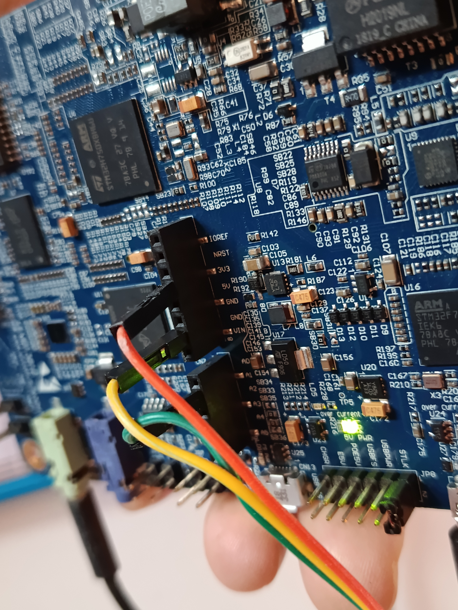
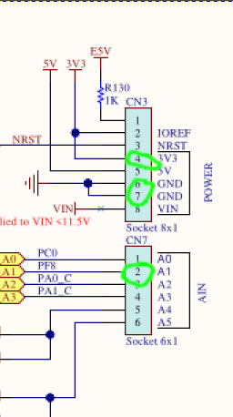


## Current MEMS vs ADC configuration:

|                     | **MEMS demo** (`plot_mems.c`)                                                                              | **ADC demo** (`plot_adc.c`)                                      |
| ------------------- | ---------------------------------------------------------------------------------------------------------- | ---------------------------------------------------------------- |
| Source              | On-board digital PDM microphone                                                                            | Analog signal on PF8 (ADC3, ch. 7)                               |
| Sample format       | 1-bit PDM stream, converted to 16-bit PCM (implemented in BSP)                                             | 16-bit unsigned raw ADC samples                                  |
| Sample timing       | Set on SAI peripheral via BSP example: at 16 kHz                                                           | Hardware-triggered by **TIM6 TRGO**: at 16khz                    |
| DMA                 | SAI/BDMA into a D3-RAM buffer (`.RAM_D3`) `recordPDMBuff`and                                               | DMA1 Stream1, circular, into `adcDmaBuffer`                      |
| Extra processing    | `BSP_AUDIO_IN_PDMToPCM()` in the DMA callbacks, writing into  `recordPCMBuff` ring buffer after conversion | None, raw samples are plotted directly                           |
| Hand-off to plotter | Callback pushes a 1024-sample segment into the queue (samples are 16bit)                                   | Callback sets `plot_flag` / `dma_wr` on the DMA half/full events |
| DC offset           | Near zero (signed PCM)                                                                                     | Non-zero (unsigned ADC), subtracted in decimation /sampling step |
| Cache handling      | D-cache invalidate on PDM input, clean on PCM output                                                       | D-cache invalidate before decimation                             |
-  Sampling MEMS microphone needs an extra **PDM → PCM** stage.
-  Both microphone use the same pipeline by packing data into `audio_segment_t` and pushing the segment  queue during DMA callbacks.

Currently the project runs on preconfigured sample sizes, but can be adjusted, since the goal was to write modular code.
- Defaults live in `audio_plotter.h` and `audio_plotter_config.h`:
## Building & running

1. Open the project in STM32CubeIDE.
2. In `main.c`, select the demo by uncommenting: `PlotMemsDemo()` or `PlotADC_demo()`.
3. Build and flash to the STM32H750B-DK.

## License

_TBD_. Parts of the code are based on STMicroelectronics BSP examples (BSD-3-Clause).

